<div align="center">

# trading-analytics

**A live, public analytics page for your Binance and Bybit futures account.**<br>
Add read-only keys, run one command, and share the link.

[**Live demo → backticks.io**](https://backticks.io)&nbsp;&nbsp;·&nbsp;&nbsp;[Quick start](#quick-start)&nbsp;&nbsp;·&nbsp;&nbsp;[What's on the page](#whats-on-the-page)&nbsp;&nbsp;·&nbsp;&nbsp;[Make it yours](#make-it-yours-without-forking)

[](LICENSE)


<br>

<a href="https://backticks.io">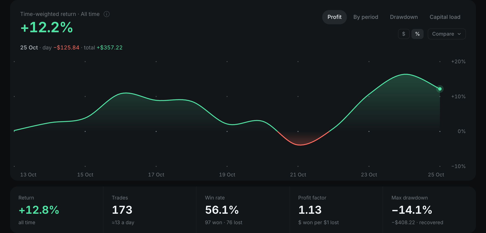</a>

</div>

<br>

Exchanges show you a PnL number. They don't show you what that number is made of. This page does. It shows the result
after fees and funding, the drawdown next to simply holding Bitcoin, the stop and target of every position, and which
hours, coins and holding times actually pay. Every closed trade is listed too.

It runs on read-only keys, on your own server. Visitors only ever see the computed report.

- **USDⓈ-M futures** on Binance, and optionally Bybit. With both, the page gets an exchange filter.
- **Time-weighted returns**, so deposits and withdrawals never count as profit.
- **Live.** The report rebuilds every minute while someone is looking.
- **English and Russian**, desktop and phone, dark.
- **No tracking, no framework, no build step** for the page. A strict CSP with no inline scripts.

<br>

## Quick start

```bash
git clone https://github.com/debut-js/trading-analytics.git
cd trading-analytics
cp .env.example .env        # put your read-only keys in
npm install && npm start
```

Open **http://localhost:3000**.

No keys yet? `npm run demo` serves a bundled sample report.

<details>
<summary><b>With Docker</b></summary>

<br>

```bash
cp .env.example .env        # fill it in
docker compose up -d
```

</details>

### Keys

Create **read-only** keys. The page never needs to trade or withdraw.

| Exchange | Where | What to tick |
|---|---|---|
| **Binance** | API Management → Create API | *Enable Reading* only. An IP restriction is recommended. |
| **Bybit** *(optional)* | API → Create New Key → System-generated | *Read-Only* |

The keys stay in `.env` on the server. The browser gets only the computed report: no keys and no account IDs.

<br>

## What's on the page

Every block below is live on [backticks.io](https://backticks.io). The windows are 30 days, 60 days, year to date and all
time, and every block follows the window and exchange you pick.

### 1 · The result


The headline numbers come first: net profit, the number of trades, the win rate and the largest drawdown. The main chart
under them has four modes:

| Mode | Shows |
|---|---|
| **Profit** | The time-weighted return curve over the window, in `$` or `%`. |
| **By period** | Each day, week, month, quarter or year as a bar. |
| **Drawdown** | How far below its last peak the account was, day by day. |
| **Capital load** | How much of the equity was tied up in positions. |

**Compare** puts a coin on the same axis. Each period then gets a grey benchmark bar beside the account's.

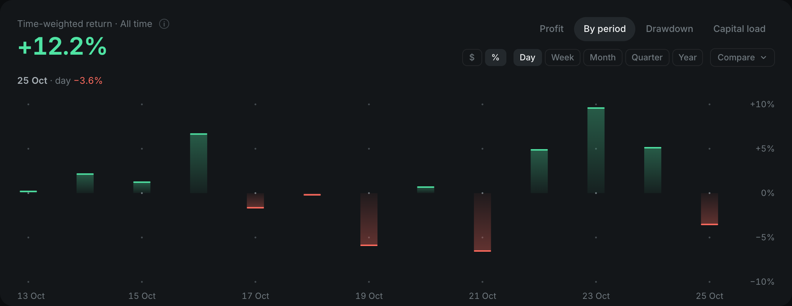

### 2 · Open positions

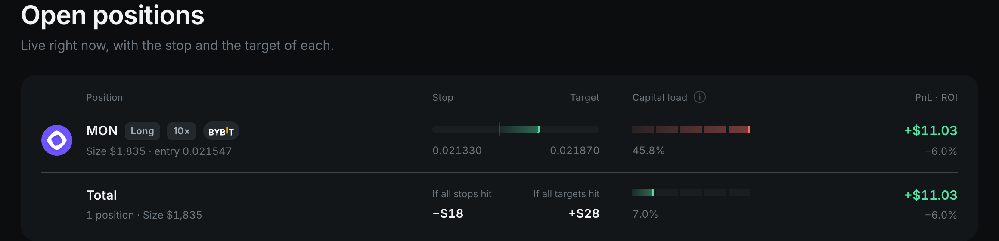

Every live position shows its size, entry, leverage and exchange. A ladder shows where the price sits between the stop and
the target, and a segmented bar shows its share of the capital. The **Total** row adds them up: what the account loses if
every stop is hit, what it gains if every target is, and the total capital load.

### 3 · Where the result came from

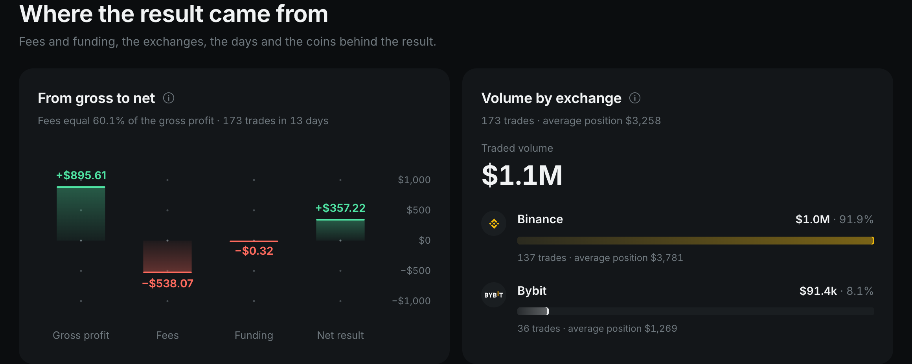

- **From gross to net** walks from gross profit through fees and funding to the net result. It is often the most sobering
  chart on the page.
- **Volume by exchange** shows the traded volume, the number of trades and the average position on each exchange.

### 4 · Days and coins

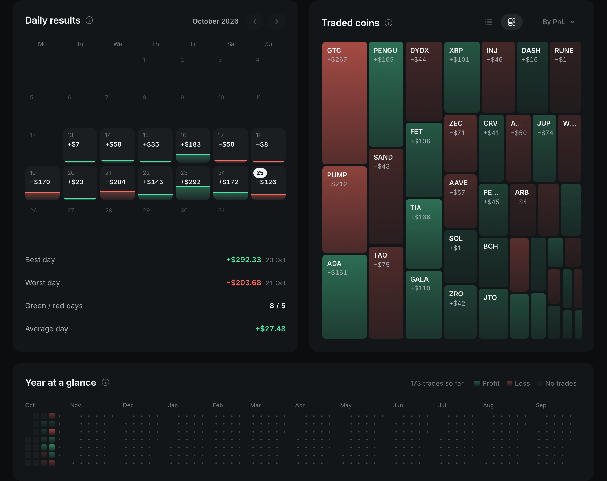

- **Daily results** is a month calendar with each day's PnL as a capped column. Under it are the best and worst day,
  green / red days and the average day.
- **Traded coins** is a heatmap or a list, sized by PnL, volume or win rate. Hover a tile for its trades, win rate and
  volume.
- **Year at a glance** is a day-by-day grid of a whole year, in the style of a contribution graph.

### 5 · How the trades behave

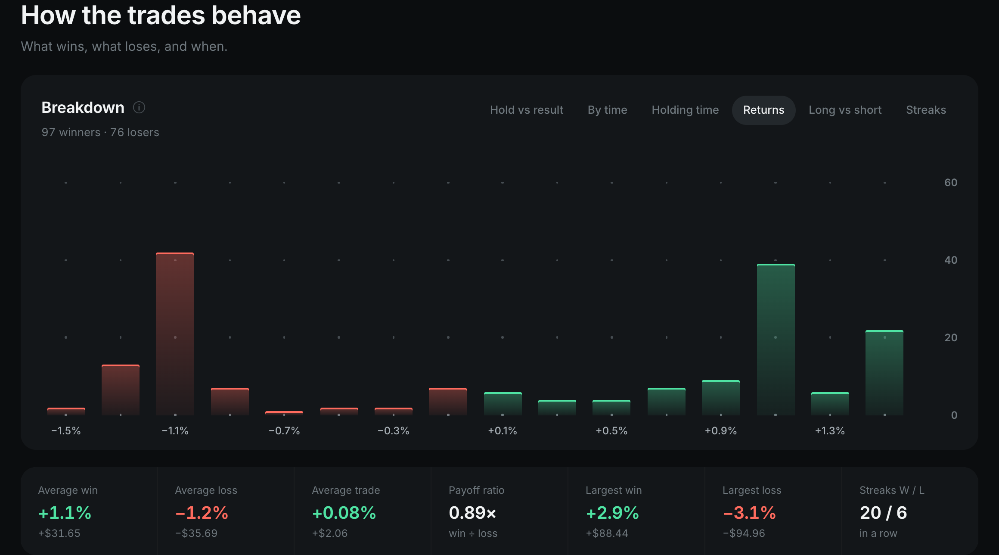

The **Breakdown** card has six tabs, each with a one-line takeaway under its title:

| Tab | Answers |
|---|---|
| **Hold vs result** | Do longer trades win more, or lose more? |
| **By time** | Win rate by hour, weekday or month, by entry or exit time. |
| **Holding time** | How long winners and losers stay open. |
| **Returns** | The spread of trade returns: how big a typical win and loss are. |
| **Long vs short** | Which side carries the result. |
| **Streaks** | Every win and loss in order, in windows of 100 trades. Flip through them with the arrows, a drag or a sideways scroll. |

A stats strip follows: average win, loss and trade, the payoff ratio, the largest win and loss, and the longest streaks.

<table>
<tr>
<td width="50%">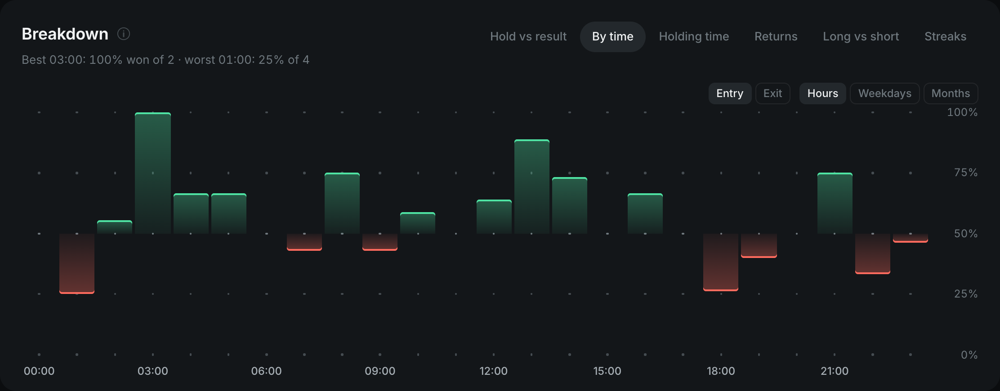</td>
<td width="50%">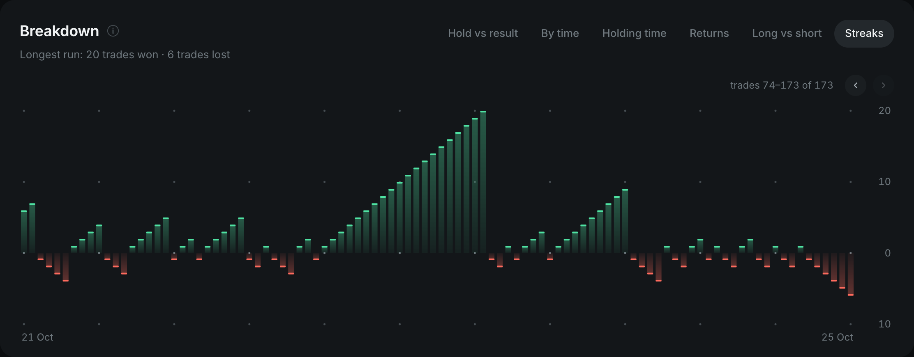</td>
</tr>
<tr>
<td align="center"><sub>By time: win rate by entry hour</sub></td>
<td align="center"><sub>Streaks: every trade in order</sub></td>
</tr>
</table>

### 6 · Risk, next to simply holding Bitcoin

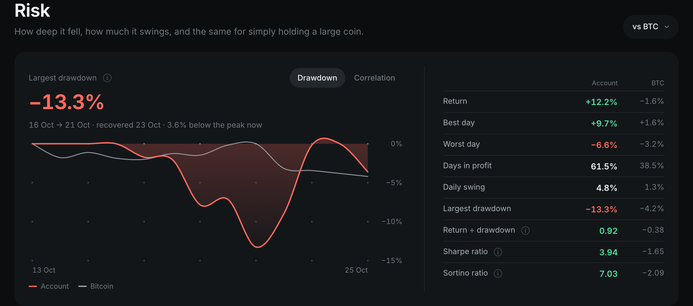

- **Drawdown** shows the account's underwater curve and a benchmark coin's on one scale. The benchmark is BTC by default
  and can be switched.
- **Correlation** shows, day by day, whether the account moved the same way as the coin, plus the running correlation.
- **The table** compares the account with the coin side by side: return, best and worst day, days in profit, daily swing,
  largest drawdown, return ÷ drawdown, Sharpe and Sortino.

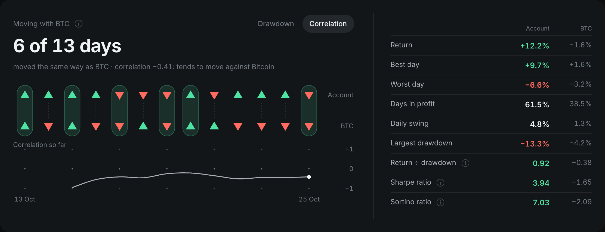

### 7 · Trades history

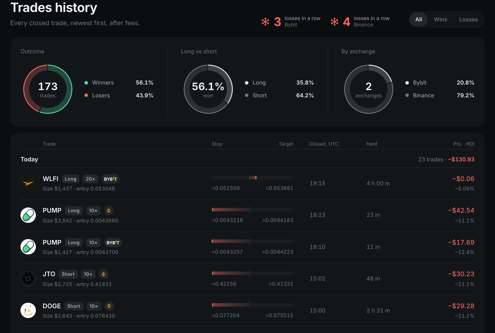

Every closed trade is listed after fees, newest first, grouped by day with each day's total. Older days load on click.
Each trade shows its entry, size, leverage, close time, holding time, PnL and ROI. Its stop and target are estimated from
the strategy's typical moves and marked with `≈`.

Above the list:

- **Three rings** split the trades by outcome, by long vs short, and by exchange.
- **Streak badges** show the current win or loss streak on each exchange.

You can filter to wins or losses and export to CSV.

### 8 · On a phone

<p align="center">
  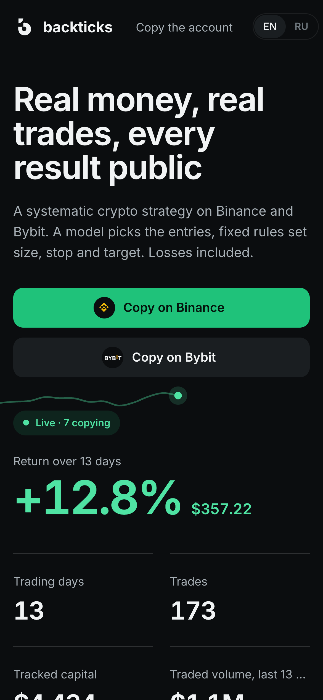
</p>

The same page on a phone. A tap shows any tooltip. Nothing scrolls sideways.

<br>

## Settings

All settings live in `.env`. [`.env.example`](.env.example) has every one, with comments.

| Variable | What it does |
|---|---|
| `BINANCE_API_KEY`, `BINANCE_API_SECRET` | The account. Without them the page loads and says the report isn't configured. |
| `BYBIT_API_KEY`, `BYBIT_API_SECRET` | A second account on Bybit. The page gets an exchange filter. |
| `TITLE`, `BRAND` | The page title, and the name in the header. |
| `SITE_HOST` | Canonical host for links and the sitemap. Also redirects `www.<host>`. |
| `DATA_START` | Ignore everything before this UTC day. |
| `INCEPTION` | The day the account started, for the returns. |
| `TRADES_DAYS` | Days of fills used to rebuild trades, 1–90 (default 30). |
| `CACHE_TTL_SECONDS` | How often the report rebuilds while someone has the page open (default 60). |
| `PORT` | Default 3000. |
| `SITE_DIR` | Your own layer over the page ([below](#make-it-yours-without-forking)). |
| `DEMO` | `1` serves the bundled sample report. A path serves your own report JSON. |
| `BINANCE_COPY_PORTFOLIO_ID`, `BYBIT_COPY_LEADER_MARK` | Lead traders only: show how many accounts copy you. |

<br>

## Make it yours without forking

Point `SITE_DIR` at a folder of your own. Updates to this repo then never conflict with your changes.

```
site/
├── slots/
│   ├── meta.html         <title>, description, Open Graph
│   ├── head.html         extra <script src="/binance-dashboard/site.js"> etc.
│   ├── body-start.html   anything right after <body>
│   ├── brand.html        the header's logo and name
│   ├── nav.html          extra header links
│   ├── hero-copy.html    the headline, the lead and your buttons
│   ├── bar-cta.html      a button in the sticky filter bar
│   ├── sections.html     your own sections after Risk
│   └── foot-brand.html   the footer's name
└── static/
    ├── site.js           served at /binance-dashboard/site.js
    ├── og.png            served at /og.png
    └── favicon.svg       served at /favicon.svg
```

Each `slots/<name>.html` replaces the `<!--slot:name-->…<!--/slot:name-->` block of [`web/page.html`](web/page.html).
A missing slot keeps the default.

To change texts, load a script through `head.html` and merge into the strings:

```js
Object.assign(window.BDCopy.en, { h1: 'My account', sub: 'Every trade, live.' });
Object.assign(window.BDCopy.ru, { h1: 'Мой счёт' });
```

Third-party scripts need their hosts in the CSP. Pass them through the plugin's `csp` option (below).

[backticks.io](https://backticks.io) is built exactly this way: this package, plus a folder with its brand, its
calls to action and its analytics.

<br>

## Use it inside your own Fastify app

```ts
import Fastify from 'fastify';
import { tradingAnalytics } from 'trading-analytics';

const app = Fastify();
await app.register(tradingAnalytics, {
  title: 'My account',
  siteDir: './site',
  csp: { script: ['https://analytics.example.com'], connect: ['https://analytics.example.com'] },
  onReport: (report) => { /* react to new trades, post them somewhere… */ },
  alwaysWarm: true,   // keep rebuilding even with no one on the page
});
await app.listen({ port: 3000 });
```

Install from GitHub at a tag:

```bash
npm i github:debut-js/trading-analytics#v0.1.2
```

The built `dist/` is committed, so nothing is compiled on install. Run `npm run build` before committing a change to
`src/`.

The analytics core can be imported on its own:

```ts
import { buildReports } from 'trading-analytics/core/report.js';
```

<br>

## How it works

```
 Binance / Bybit  ──read-only──▶  src/core      fills → trades, time-weighted returns, drawdowns,
   REST API                                     windows, insights, capital load
                                     │
                                     ▼
                                  src/plugin    Fastify: one report in memory, rebuilt in the
                                                background while someone is looking; strict CSP
                                     │
                                     ▼  /binance-dashboard/report.json
                                  web/          plain HTML, CSS and JS; no framework, no build
```

- **Trades are rebuilt from fills.** A trade runs from flat to flat on one symbol, with its fees and funding attached.
- **Returns are time-weighted.** A deposit doesn't count as profit, and a withdrawal doesn't count as a loss.
- **Visitors share one build.** It stays well inside the exchanges' limits: a report costs about 1000 of Binance's 2400
  weight per minute. When an exchange has a bad moment, the last good report is served.

<br>

## Disclaimer

This is a reporting tool, not financial advice. Past results say nothing certain about future ones. Use read-only keys,
and only show what you're happy to make public.

## License

[MIT](LICENSE)
